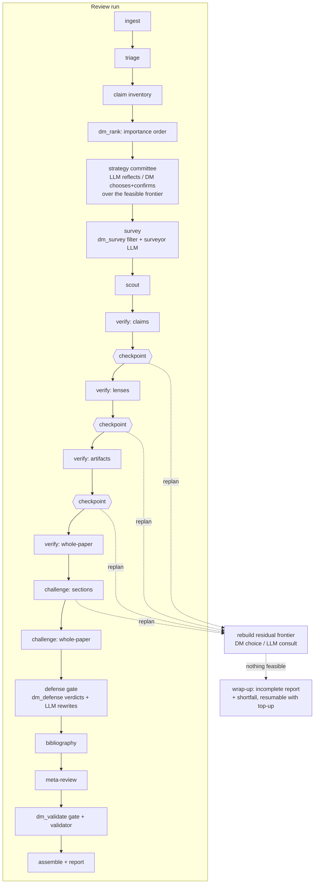

# The open-referee pipeline — components, control plane, and planning protocols

This document is the canonical map of the review process: the flow, every
atomic component with its characteristics, and the budget/decision protocols
that plan and steer a run. It is the vocabulary the harness, the planning
committee, and the decision models share.

## Flow

The desk-reject estimator is a separate product:
`ingest → preflight → LLM editor (six factor analyses, each ≤600 tokens) →
decision model predicate over profile+analyses → FitReport`.

## Component catalogue

Each component is atomic: one budgeted call type, independently plannable,
skippable by a plan, and measurable in the run history. "Est. tokens" are the
cost model's functions of document stats (chars C, sections S, claims N).

| Component | Stage | Who | Function | Est. tokens (in/out) | Scales with |
|---|---|---|---|---|---|
| ingest | ingest | — | document → blocks/sections/figures/tables (free) | 0 | — |
| triage | triage | strong | domain, queries, key citations, main claims | C/3+800 / ~1.3k | C |
| dm_triage | triage | decision | closed-set classification: type, math density, stats content, style | C/3 / 1 | C |
| claim_inventory | claims | strong | catalogue atomic checkable claims | C/3+1.2k / ~5k | C |
| dm_rank | claims | decision | total importance order over claims (rubric, batched) | N·0.3k / 1 | N |
| strategy reflect | plan | strong | draft → self-challenge → evaluation (no commit) | ~3k / ~1.5k | — |
| dm_steer / dm_confirm | plan | decision | choose + confirm a frontier path or continuation | briefing / 1 | — |
| surveyor | survey | small | rank context pack, missing refs | ~4k / ~1.5k | pack |
| dm_survey | survey | decision | relevance predicate per item (batched) | pack/3 / 1 | pack |
| scout | scout | — | PubPeer/OpenReview/PREview (no LLM cost) | 0 | — |
| claim_verify | verify | strong+small | one call per claim, isolated definitions pack | ~7k / ~1.2k | N (ranked) |
| lens_section | verify | small | per section × lens grid | S·(~4k) / ~2k | S, lenses |
| artifact_verify | verify | vision | every figure/table vs prose | ~6k / ~2k | artifacts |
| whole_paper_verify | verify | strong | cross-section coherence | C/3+0.9k / ~3k | C |
| section_challenger | challenge | strong | per-section adversarial re-read | S·(~8k) / ~2.5k | S |
| whole_paper_challenge | challenge | strong | global weaknesses hunt | C/3+10k / ~3k | C |
| defense | challenge | small | authors' best defense per comment | ~2.2k / ~0.9k | comments |
| dm_defense | challenge | decision | uphold/adjust/dismiss + severity, batched | comments/3 / 1 | comments |
| adjudication (rewrite) | challenge | small | rewrite 'adjust' comments only | ~2.8k / ~0.9k | adjusted |
| bibliography | bibliography | small | citation existence + quotation audit | ~22k / ~3k | refs |
| meta | meta | strong | dedupe, severity, overall report | ~34k / ~4k | comments |
| dm_validate | validate | decision | grounded-quote predicate per comment | comments/3 / 1 | comments |
| validate | validate | strong | final gate over survivors | C/3+27k / ~4k | C |
| assemble | assemble | — | anchor resolution, exports (free) | 0 | — |
| wrapup | any | strong | incomplete-review synthesis (reserve-funded) | C/3+28k / ~4k | C |
| fit_assessment | fit | strong | six factor analyses (≤600 tok each) + reasoning | C/3+2k / ~4k | C |
| dm_fit | fit | decision | desk-screen predicate over editor output | profile+factors / 1 | — |

Control-plane types (triage, claim_inventory, surveyor, planner, dm_*) are
booked separately from review-plane work in every plan and history record.

## Preset modes (fast / standard / deep) — uncapped

Once a paper is loaded the harness prices all three presets **mechanically**
(`POST /api/estimate`, zero model calls). Preset runs have **no cap and no
in-flight replanning**: the estimate is informational and the report shows
estimate-vs-actual per stage. Knobs: fast = 20 claims/no lenses/no defense;
standard = 60 claims/all passes; deep = 150 claims/all passes.

## Budget-driven mode (auto)

1. **Floor**: a budget below the *fast-preset estimate* for the loaded paper
   is rejected before any model call, with all three estimates in the message.
2. **Frontier**: the harness deterministically constructs ~10 feasible plans
   across the depth axis (claims by importance rank: 0/10/25/50/all, defense
   gate on/off) × breadth axis (lenses / whole-paper / artifacts / bibliography).
   Every path is feasible **by construction** — nothing can commit an
   infeasible plan. A wrap-up reserve (≈ one strong synthesis call) is kept
   aside so an incomplete run can always be wrapped up.
3. **Strategy committee** (after claims + dm_rank): the strong LLM *reflects*
   (draft → self-challenge → evaluation; no commit authority, never sums
   costs) → the decision model *chooses* a frontier path over that reasoning →
   the decision model *confirms*; a rejected confirmation triggers exactly one
   more decision round over all paths, which commits unconditionally.
4. **Checkpoints** after every stage and verify sub-stage; a spike detector
   (a booked call ≥8× its estimate) forces an immediate checkpoint.
5. **Replanning** is unbounded in count. Each replan rebuilds a **residual
   frontier** (4-5 continuations) from residual steps + residual budget with
   the ranked-claim context and **observed yield** (findings per pass — depth
   vs breadth decisions are made on evidence). Single-option repairs apply
   deterministically with no call; multi-option choices go to the decision
   model (escalating to one LLM consultation below 0.5 confidence).
6. **Wrap-up**: when nothing is feasible, the reserve funds a strong-model
   synthesis of the best possible report; the run is flagged **incomplete**
   with the estimated shortfall and can be **resumed with a budget top-up**
   without rerunning completed stages (artifacts + ledger are persisted).

## Decision models

Typed evaluation API (`POST {base_url}/v1/decisions`): predicate / choice /
score questions over one shared input, answered with typed results and full
probability distributions in a single forward pass. Configured as a
`decision` provider + `decision` role; input-only pricing (explicit 0.0
output is valid). Integrated at: fit verdict, claim ranking, strategy
choose/confirm, replan choices, triage classification, surveyor filtering,
defense verdicts + severity, validator grounding gate.

**Not yet integrated (candidates, with trade-offs):**
- *Artifact-mismatch flags* (predicate per figure/table finding) — pro: cheap
  precision filter; con: the vision pass already grounds findings.
- *Venue-tier routing* (choice over profile) — pro: better preset suggestion;
  con: overlaps the fit product's job.
- *Meta severity jury* (score rubric over final comments) — pro: consistent
  severities; con: double-scoring after dm_defense already recalibrated.
